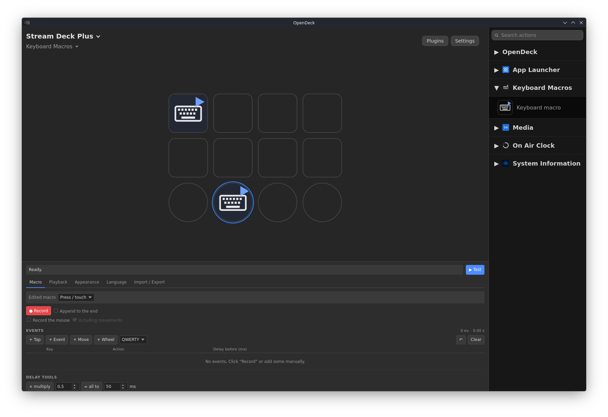

<p align="center">
  
</p>

<h1 align="center">Keyboard Macros for OpenDeck</h1>

An [OpenDeck](https://github.com/nekename/OpenDeck) plugin that records keyboard and mouse sequences with their timing, lets you edit them, and replays them from a deck key or a Stream Deck+ dial. It runs on Linux, Windows and macOS, and its interface is available in English and French.



## Requirements

The plugin is a single self-contained executable: OpenDeck needs **no runtime** (no Python, no Node.js) to run it.

On **Linux**, your user needs access to the input devices:

| Access | Why | How to get it |
|---|---|---|
| Read/write access to `/dev/uinput` | Simulating keyboard and mouse input | Add your user to the `input` group (`sudo usermod -aG input $USER`), then log out and back in. Some distributions grant it to the logged-in user already. |
| Read access to `/dev/input/event*` | Recording keyboard and mouse input | Same `input` group as above. |

On **macOS** (10.15 or newer), allow OpenDeck in System Settings → Privacy & Security:
- **Accessibility**, to replay macros;
- **Input Monitoring**, to record them.

macOS asks the first time the plugin needs them. Restart OpenDeck after allowing it.

On **Windows**, nothing is needed. Windows does not let a normal program send input to a window running as administrator.

If something is missing, the plugin's editor shows a red banner that says what to do, with a link to the **[setup guide](docs/SETUP.md)** for your system. The same check runs when OpenDeck starts and is written to OpenDeck's log.

## Installation

Download `KeyboardMacros-<version>.zip` from the [releases](https://github.com/MrBretze/Keyboard-Macros/releases), then in OpenDeck use Plugins → "Install from file", and restart OpenDeck.

The zip contains executables for Linux x86_64, Linux ARM64 (aarch64), Windows x86_64 and macOS (one universal executable for Intel and Apple Silicon). OpenDeck picks the right one.

| Platform | Status |
|---|---|
| Linux x86_64 | Tested with OpenDeck (Flatpak) on KDE Plasma, Wayland. X11 and native OpenDeck packages are expected to work but have not been tried. |
| Linux ARM64 | Built and unit-tested automatically, not yet tried on a real machine |
| Windows 10 / 11 | Tested on Windows with [Tacto](https://tacto.live) |
| macOS 10.15+ | Built and unit-tested automatically, not yet tried on a real Mac. The executable is not signed by Apple, so macOS may refuse to start it. |

The plugin follows the Stream Deck SDK. It has not been tried with Elgato's Stream Deck software.

### Building from source

You need [Rust](https://rustup.rs) 1.85 or newer.

- **Linux**: `./install.sh` builds a static executable (`musl` target) and copies the plugin into OpenDeck's plugin folder (Flatpak or native).
- **Windows**: `powershell -ExecutionPolicy Bypass -File install.ps1` builds and installs the plugin. Add `-StreamDeck` to install it into the Elgato software instead.
- **macOS**: run `cargo build --release`, copy `target/release/keymacro` to `com.mrbretzel.keymacro.sdPlugin/keymacro-macos`, then copy the plugin folder into OpenDeck's plugin folder.

## Usage

The settings panel has a status bar with a "▶ Test" button, and six tabs:

- **Macro** (default tab): record and edit the macro.
  - Click "● Record", type your sequence, then click "■ Stop" or press the deck key. "Append to the end" adds the recording after the existing macro instead of replacing it.
  - "Record the mouse" (off by default) also records mouse buttons and the wheel, and, with "including movements", mouse movements. When you stop with the editor's "■ Stop" button, the click on that button and the last continuous movement before it (the trip to the button) are left out; a gesture followed by a short pause is kept. To keep a gesture exactly as made, stop with the deck key instead.
  - Each row is one event (press or release) with its delay in ms since the previous event. You can change the key, switch press/release, disable, move, duplicate or delete rows. Ctrl+Z undoes. Key names follow your system: Super on Linux, Win on Windows, ⌘ Command on macOS.
  - Mouse buttons appear in the table like keys ("Left click"...). Movements and wheel notches have their own rows with editable x / y values. "+ Move" and "+ Wheel" add them by hand.
  - Delay tools: multiply, set, round or cap all delays, or remove all mouse movements (their delays move to the next event, so the timing is unchanged).
- **Playback**: speed in %, number of repeats (0 = loop), pause between repeats, fixed delay instead of the recorded ones.
- **Appearance**: default icon, custom image or plain color, with or without text on top. The text has adjustable size, color, position, font, bold and outline. A state indicator (playing / recording) can be shown in a corner, with a preview of all 3 states.
- **Language**: automatic (OpenDeck's language, then the system language) or forced. The choice applies to every key that uses the plugin.
- **Import / Export**: the text area always shows the current macro as JSON, ready to copy. To import, paste or edit JSON there and click "Import".
- **About**: installed version, platform, OpenDeck version, connected decks and links (GitHub, report a problem, license). After a recording is saved, the key briefly shows a check mark.
  - **Diagnostics** check what the plugin needs. On Linux: `/dev/uinput`, input device access, keyboards and mice available for recording. On Windows: the keyboard and mouse hooks. On macOS: the Accessibility and Input Monitoring permissions. "Copy report" puts everything useful for a bug report in the clipboard.
  - **Log** shows the end of `plugin.log`, with buttons to refresh, copy, open its folder or clear it. "Verbose log (debug)" also logs every message exchanged with OpenDeck and every replayed macro. It applies to all actions and is remembered. See [Security and privacy](#security-and-privacy).

Buttons that delete something ("Clear") ask for a second click to confirm.

On the deck, pressing the key plays the macro, and pressing it again during playback stops it.

### Dials (Stream Deck+)

The action can also be placed on a dial. A dial has three macros, chosen with "Edited macro" at the top of the Macro tab:

| Dial input | Macro |
|---|---|
| Press the dial, or tap its touch-strip segment | Press / touch: plays the macro, pressing again stops it (same as a key) |
| Turn right | Turn right: plays once per notch |
| Turn left | Turn left: plays once per notch |

Notches turned while a turn macro is playing are queued, up to 50. Turning the other way drops the queued notches of the previous direction. "Repeat" only applies to the press macro, while the other playback options apply to all three. Example: Volume Up / Volume Down on the turns and Play/Pause on the press.

## Security and privacy

- **What the plugin can do.** It can simulate any keyboard and mouse input, and, while you record, read every keyboard (and mouse, if enabled) on the system. This is why it needs the access described in [Requirements](#requirements).
- **When it listens.** Only between "● Record" and "■ Stop". Recording does not block your devices: everything you type during a recording is recorded, in any window, **including passwords**. Do not type secrets while recording.
- **Where macros are stored.** In the action settings, as plain text, in OpenDeck's profile files. Anyone who can read your OpenDeck configuration, or a profile you share, can read your macros.
- **The log.** It records errors, device names and event counts, not what you type. These lines also appear in OpenDeck's own log, prefixed with `[Keyboard Macros]`. The only key it may mention is one that cannot be replayed on your system. The verbose log (debug) records every message exchanged with OpenDeck, which includes macros and recorded keys. Turn it off when you are done, and check a report before you share it. Times are in UTC. Past 1 MB, the log is renamed `plugin.log.old` and a new one starts.
- **Network.** The plugin only talks to OpenDeck, over a local connection (`127.0.0.1`), using the official [`openaction`](https://crates.io/crates/openaction) crate. The links in the About tab are opened by OpenDeck in your browser. The plugin only opens its own three pages, whatever the editor asks.
- **Unplugging a deck** stops the macros started from it, so a looping macro cannot keep running without a key to stop it.
- **Limits that protect against mistakes:**
  - a recording keeps at most 100,000 events;
  - a single delay is capped at one hour;
  - imported or edited events with invalid values are skipped.

To report a security problem, open an issue on GitHub, without sensitive details, and say you want to discuss it privately.

## Troubleshooting

1. Follow the **[setup guide](docs/SETUP.md)**. The red banner in the plugin's editor links to it. Then open the **About** tab and click **Run checks**: every failing check explains what is still missing.
2. Most problems on Linux come from the `input` group. After `sudo usermod -aG input $USER`, log out and back in (a restart of OpenDeck alone is not enough).
3. If something still goes wrong, turn on **Verbose log (debug)**, reproduce the problem, then **Copy report** and paste it into a [GitHub issue](https://github.com/MrBretze/Keyboard-Macros/issues). Read it first: it may contain the keys you recorded.

## How it works

For the full picture (the engine process and its threads, playback and recording step by step, the messages exchanged with OpenDeck, and where data is stored), see [docs/ARCHITECTURE.md](docs/ARCHITECTURE.md). In short:

- The engine is a **single background process**, started by OpenDeck and running as long as OpenDeck is open, for all the keys that use the plugin. It uses about 1 MB of memory and no CPU while idle. The editor is a web page shown by OpenDeck only while an action is selected.
- Macros store **physical key** codes (Linux evdev codes). A macro replays the same physical keys whatever the keyboard layout, on every operating system. The AZERTY/QWERTY selector only changes the key names shown in the table.
- **Mouse movements** are relative. To keep the macro readable, the small movements a mouse reports (up to 1,000 per second) are merged over about 12 ms into one row, which remembers how many reports it holds (`n`). Playback splits each row back into those small steps at the original pace, so the desktop applies the same pointer acceleration as during the recording and the cursor follows the same path. The fixed delay option does not apply to movements, so gestures keep their speed.
- **Linux**:
  - Keys are sent through a virtual `uinput` keyboard, and mouse input through a separate virtual mouse. This works on Wayland and X11.
  - Recording reads keyboards (and mice, when enabled) through evdev, opened read-only and without grabbing them.
  - Wayland gives no absolute cursor position, so a replayed movement goes through the pointer acceleration again and can land slightly off. Touchpad movement is not recorded (only its clicks).
- **Windows**:
  - Keys are sent with `SendInput` as scan codes. Mouse buttons and the wheel also go through `SendInput`. Movements move the cursor directly, so they replay exactly.
  - Recording uses low-level keyboard and mouse hooks. Simulated input is ignored.
  - Brightness keys are not supported.
- **macOS**:
  - Keys, mouse buttons, movements and the wheel are sent as CoreGraphics events. Movements place the cursor exactly.
  - Recording uses a listen-only event tap. Simulated input is ignored.
  - Keys without a Mac equivalent are not supported: Scroll Lock, Print Screen, Pause, Power, media and browser keys, brightness and F21-F24.
  - A macro replays physical keys: Ctrl+C recorded on Linux stays Ctrl+C on a Mac, it does not become ⌘+C.
- Custom key images are drawn in the settings panel and stored in the action settings. The plugin then sends the right image to the deck for each state.

## Development

```bash
cargo test                         # unit tests
cargo fmt                          # formatting (rustfmt.toml)
cargo clippy --all-targets         # lints; add --target x86_64-pc-windows-gnu or aarch64-apple-darwin to check the other platforms
cargo audit                        # known vulnerabilities in dependencies (cargo install cargo-audit)
```

The Windows and macOS code can be checked from Linux with `rustup target add x86_64-pc-windows-gnu aarch64-apple-darwin` and `cargo clippy --target <target>`.

Every push and pull request runs the tests and builds all platforms on GitHub Actions. Pushing a `v*` tag that matches `Version` in the manifest attaches the zip to the matching GitHub release.

### Adding a language

1. Copy `com.mrbretzel.keymacro.sdPlugin/pi/locales/en.js` to `<code>.js` in the same folder and translate the values. Keys such as `key.LEFTMETA.mac` are platform-specific variants of `key.LEFTMETA`.
2. In `pi/index.html`, add a `<script>` tag for that file and an `<option>` to the language selector.
3. For the plugin name, copy `lang/en.json` to `lang/<code>.json` and translate it. OpenDeck does not read these files. The Elgato Stream Deck software reads them from the plugin root, where `install.ps1 -StreamDeck` copies them.

### Files

| File | Purpose |
|---|---|
| `src/main.rs` | Entry point: arguments, async runtime |
| `src/plugin.rs` | Plugin logic: events, playback, dial queue, recording, key images, About tab commands |
| `src/recorder.rs` | Recording logic shared by every platform (filtering, merging, delays, limits) |
| `src/input/linux.rs`, `windows.rs`, `macos.rs` | Keyboard and mouse simulation, capture and diagnostics for each OS |
| `src/host.rs` | Connection to OpenDeck through the [`openaction`](https://crates.io/crates/openaction) crate |
| `src/common.rs` | Shared helpers: macro format, key codes, logging |
| `com.mrbretzel.keymacro.sdPlugin/` | The plugin folder: `manifest.json`, icons, editor (`pi/`) and plugin name translations (`lang/`) |
| `pi/index.html` | Editor (Property Inspector) |
| `pi/i18n.js`, `pi/locales/*.js` | Editor translations |
| `pi/appearance.js` | Custom key image rendering |
| `pi/keys.js` | Key table and per-platform key names |
| `install.sh`, `install.ps1` | Build from source and install (Linux, Windows) |
| `.github/workflows/release.yml` | Tests, builds and packages all platforms |
| `docs/SETUP.md` | Setup guide (permissions, uinput module), linked from the editor's setup banner |
| `docs/ARCHITECTURE.md` | How the plugin works inside OpenDeck |
| `AGENTS.md`, `CLAUDE.md` | Instructions for AI coding agents (CLAUDE.md imports AGENTS.md) |
| `rustfmt.toml` | Formatting settings |
| `data/` | Logo and screenshot used by this README |

## License

Copyright (c) 2026 MrBretzel.

This project is distributed under the [CeCILL v2.1](LICENSE) free software license (SPDX: `CECILL-2.1`), a French copyleft license compatible with the GNU GPL. The French and English versions of the license are equally authentic; the official texts are at https://cecill.info.

You may use, copy, modify and redistribute this software, provided that:
- you keep the copyright notice and this license;
- any distributed copy or modified version is released under the same license, with its source code.
