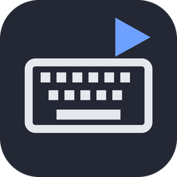

  

<h1 align="center">Keyboard Macros for OpenDeck</h1>

An OpenDeck (and Stream Deck) plugin that records keyboard and mouse sequences with their timing, lets you edit them, and replays them from a deck key. It works with keys and Stream Deck+ dials, runs on Linux, Windows and macOS, and its interface is available in English and French.

## Requirements

The plugin is a single self-contained executable: OpenDeck needs **no runtime** (no Python, no Node.js) to run it.

On **Linux**, your user needs access to the input devices:

| Access | Why | How to get it |
|---|---|---|
| Read/write access to `/dev/uinput` | Simulating keyboard and mouse input | Add your user to the `input` group (`sudo usermod -aG input $USER`), then log out and back in. Some distributions grant it to the logged-in user already. |
| Read access to `/dev/input/event*` | Recording keyboard and mouse input | Same `input` group as above. |

On **macOS** (10.15 or newer), allow OpenDeck in System Settings → Privacy & Security:
- **Accessibility**, to replay macros;
- **Input Monitoring**, to record them.

macOS asks the first time the plugin needs them. Restart OpenDeck after allowing it.

If an access is missing, the editor shows an error explaining what to fix, and the About tab's diagnostics check it.

## Installation

Install it from OpenDeck's plugin list, or download `KeyboardMacros-<version>.zip` from the [latest release](https://github.com/MrBretze/Keyboard-Macros/releases/latest) and use "Install from file" in OpenDeck. Then restart OpenDeck.

The release contains executables for Linux x86_64, Linux ARM64 (aarch64), Windows x86_64 and macOS (one universal executable for Intel and Apple Silicon). OpenDeck picks the right one.

Windows and macOS support is built and unit-tested automatically, but has not been tried on a real Windows machine or Mac yet. The macOS executable is not signed by Apple, so macOS may refuse to start it.

### Building from source

You need [Rust](https://rustup.rs).

- **Linux**: `./install.sh` builds a static executable (`musl` target) and copies the plugin into OpenDeck's plugin folder (Flatpak or native).
- **Windows**: `powershell -ExecutionPolicy Bypass -File install.ps1` builds and installs the plugin. Add `-StreamDeck` to install it into the Elgato software instead.
- **macOS**: run `cargo build --release`, copy `target/release/keymacro` to `com.mrbretzel.keymacro.sdPlugin/keymacro-macos`, then copy the plugin folder into OpenDeck's plugin folder.

`cargo test` runs the unit tests. Every push builds all platforms on GitHub Actions. Pushing a `v*` tag attaches the zip to the matching release.

## Usage

The settings panel has a status bar with a "▶ Test" button, and six tabs:

- **Macro** (default tab): record and edit the macro.
  - Click "● Record", type your sequence, then click "■ Stop" or press the deck key. "Append to the end" adds the recording after the existing macro instead of replacing it.
  - "Record the mouse" (off by default) also records mouse buttons and the wheel, and, with "including movements", mouse movements. When you stop with the editor's "■ Stop" button, the click on that button and the movement to reach it are left out.
  - Each row is one event (press or release) with its delay in ms since the previous event. You can change the key, switch press/release, disable, move, duplicate or delete rows. Ctrl+Z undoes.
  - Mouse buttons appear in the table like keys ("Left click"...). Movements and wheel notches have their own rows with editable x / y values. "+ Move" and "+ Wheel" add them by hand.
  - Delay tools: multiply, set, round or cap all delays, or remove all mouse movements (their delays move to the next event, so the timing is unchanged).
- **Playback**: speed in %, number of repeats (0 = loop), pause between repeats, fixed delay instead of the recorded ones.
- **Appearance**: default icon, custom image or plain color, with or without text on top. The text has adjustable size, color, position, font, bold and outline. A state indicator (playing / recording) can be shown in a corner, with a preview of all 3 states.
- **Language**: automatic (OpenDeck's language, then the system language) or forced.
- **Import / Export**: the text area always shows the current macro as JSON, ready to copy. To import, paste or edit JSON there and click "Import".
- **About**: installed version, platform, OpenDeck version and links (GitHub, report a problem, license).
  - **Diagnostics**: checks access to `/dev/uinput` and the input devices, lists the keyboards and mice available for recording (Linux), or tests the keyboard and mouse hooks (Windows). "Copy report" puts everything useful for a bug report in the clipboard.
  - **Log**: shows the end of `plugin.log`, with buttons to refresh, copy, open its folder or clear it. "Verbose log (debug)" also logs every message exchanged with OpenDeck and every replayed macro; it applies to all actions and is remembered.

On the deck, pressing the key plays the macro, and pressing it again during playback stops it.

### Dials (Stream Deck+)

The action can also be placed on a dial. A dial has three macros, chosen with "Edited macro" at the top of the Macro tab:

| Dial input | Macro |
|---|---|
| Press the dial, or tap its touch-strip segment | Press / touch: plays the macro, pressing again stops it (same as a key) |
| Turn right | Turn right: plays once per notch |
| Turn left | Turn left: plays once per notch |

Notches turned while a turn macro is playing are queued, up to 50. Turning the other way drops the queued notches of the previous direction. "Repeat" only applies to the press macro, while the other playback options apply to all three. Example: Volume Up / Volume Down on the turns and Play/Pause on the press.

## Adding a language

1. Copy `pi/locales/en.js` to `pi/locales/<code>.js` and translate the values.
2. In `pi/index.html`, add a `<script>` tag for that file and an `<option>` to the language selector.
3. For the plugin name, copy `lang/en.json` to `lang/<code>.json` and translate it. OpenDeck does not read these files; the Elgato Stream Deck software reads them from the plugin root, where `install.ps1 -StreamDeck` copies them.

## How it works

- Macros store **physical key** codes (Linux evdev codes). A macro replays the same physical keys whatever the keyboard layout, and works on both operating systems. The AZERTY/QWERTY selector only changes the key names shown in the table.
- **Mouse movements** are relative, merged over about 12 ms so the macro stays readable. The fixed delay option does not apply to them, so gestures keep their speed.
- **Linux**:
  - Keys are sent through a virtual `uinput` keyboard, and mouse input through a separate virtual mouse. This works on Wayland and X11.
  - Recording reads keyboards (and mice, when enabled) through evdev without grabbing them.
  - Wayland gives no absolute cursor position, so a replayed movement goes through the pointer acceleration again and can land slightly off. Touchpad movement is not recorded (only its clicks).
- **Windows**:
  - Keys are sent with `SendInput` as scan codes.
  - Mouse buttons and the wheel are sent with `SendInput`. Movements move the cursor directly, so they replay exactly.
  - Recording uses low-level keyboard and mouse hooks, and simulated input is ignored.
  - Brightness keys are not supported.
  - Windows blocks keystrokes sent to windows running as administrator.
- **macOS**:
  - Keys, mouse buttons, movements and the wheel are sent as CoreGraphics events. Movements place the cursor exactly.
  - Recording uses a listen-only event tap, and simulated input is ignored.
  - Keys without a Mac equivalent are not supported: Scroll Lock, Print Screen, Pause, Power, media and browser keys, brightness and F21-F24.
  - A macro replays physical keys: Ctrl+C recorded on Linux stays Ctrl+C on a Mac, it does not become ⌘+C.
- Custom key images are drawn in the settings panel and stored in the action settings. The plugin then sends the right image to the deck for each state.
- Log: `plugin.log` in the installed plugin folder (times in UTC), also shown in the About tab. Past 1 MB it is renamed `plugin.log.old` and a new one starts.

## Files

| File | Purpose |
|---|---|
| `src/main.rs` | Entry point: arguments, connection to OpenDeck |
| `src/plugin.rs` | Plugin logic: events, playback, dial queue, recording, key images |
| `src/recorder.rs` | Recording logic shared by every platform (filtering, merging, delays) |
| `src/input/linux.rs` / `windows.rs` / `macos.rs` | Keyboard and mouse simulation and capture for each OS |
| `src/ws.rs`, `src/common.rs` | WebSocket connection; shared helpers (macro format, logging) |
| `.github/workflows/release.yml` | Builds, tests and packages all platforms |
| `com.mrbretzel.keymacro.sdPlugin/` | The plugin folder: manifest, icons and editor |
| `pi/index.html` | Editor (Property Inspector) |
| `pi/i18n.js`, `pi/locales/*.js` | Editor translations |
| `pi/appearance.js` | Custom key image rendering |
| `pi/keys.js` | Key table |
| `lang/en.json`, `lang/fr.json` | Translated plugin name and description (Stream Deck format) |
| `data/` | Logo and screenshot used by this README |

## License

Copyright (c) 2026 MrBretzel.

This project is distributed under the [CeCILL v2.1](LICENSE) free software license (SPDX: `CECILL-2.1`), a French copyleft license compatible with the GNU GPL. The French and English versions of the license are equally authentic; the official texts are at https://cecill.info.

You may use, copy, modify and redistribute this software, provided that:
- you keep the copyright notice and this license;
- any distributed copy or modified version is released under the same license, with its source code.
