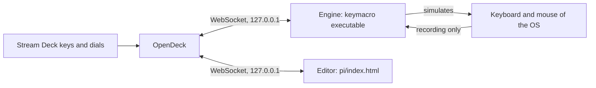
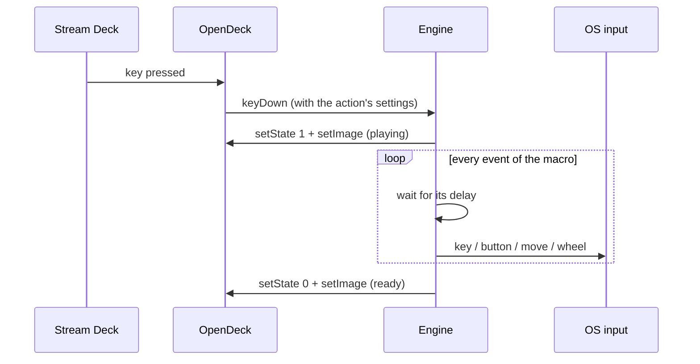

# How Keyboard Macros works

This document explains how the plugin runs inside OpenDeck: which processes exist, when they start and stop, what they say to each other, and where data is kept. For installation and usage, see the [README](../README.md).

## Overview

The plugin has two parts, which never talk to each other directly. OpenDeck relays every message between them.

| Part | What it is | Where it runs | When it runs |
|---|---|---|---|
| **Engine** | A native executable (`keymacro-…`), written in Rust | Its own process, started by OpenDeck | All the time OpenDeck is open |
| **Editor** (Property Inspector) | A web page (`pi/index.html`) | OpenDeck's embedded browser | Only while an action of the plugin is selected in OpenDeck |



## Lifecycle of the engine

There is **one engine process for all the keys and dials** that use the plugin. It is not started when a key is pressed: it runs in the background as long as OpenDeck is open, like every OpenDeck and Stream Deck plugin.

1. **OpenDeck starts.** It launches the executable that matches the system, as listed in `CodePaths` in `manifest.json`, with `-port <p> -pluginUUID <id> -registerEvent <event> -info <json>`.
2. **The engine connects.** Through the [`openaction`](https://crates.io/crates/openaction) crate, the official Rust library of the OpenAction plugin API, it opens a WebSocket to `127.0.0.1:<port>`, registers itself, notes the decks listed in `-info`, and asks for its global settings: the interface language and the verbose log switch. From then on, the engine's log lines also go to OpenDeck's own log (`logMessage`), except verbose ones.
3. **Idle.** The engine waits for messages. Measured on Linux: about 1.3 MB of memory and no measurable CPU time.
4. **A key or dial appears** (`willAppear`), for example after a profile or page change. The engine receives that action's settings and shows its image.
5. **A key is pressed** (`keyDown`, `dialDown`, `touchTap`, `dialRotate`). A playback thread replays the macro, then ends. See [Playback](#playback).
6. **The editor asks to record.** A recording thread reads the keyboards until "Stop". See [Recording](#recording).
7. **A deck is unplugged** (`deviceDidDisconnect`). The macros started from its keys stop: once the deck is gone, pressing the key again is no longer possible, so a looping macro would never end otherwise.
8. **OpenDeck closes.** The WebSocket closes. The engine stops any recording or playback, releases the keys it still holds, removes its virtual devices and exits.

### Threads

| Thread | Lives | Role |
|---|---|---|
| Async runtime (tokio, 2 worker threads) | Whole session | Runs the `openaction` crate: the WebSocket, the decoding of OpenDeck's events, and the calls to `Plugin`'s `on_*` entry points (`src/host.rs`). Events are handled one at a time, in order. |
| Delivery task (on the runtime) | Whole session | Sends the `Outgoing` messages queued by any thread, one after the other, so OpenDeck receives them in the order they were produced. No thread ever waits for the network (`host::deliver`). |
| Playback | One per playing key, until its macro ends | Replays the events with their delays (`Plugin::play_pass`) |
| Recording | From "Record" to "Stop" | Reads keyboards (and mice, if enabled) and turns them into events (`src/recorder.rs` and the platform backend) |

The shared state (settings, key states, running playbacks, dial queues, current recording) sits behind a single lock in `Plugin`. `Plugin` itself is synchronous: `host.rs` is the only place that deals with async code and the `openaction` crate.

## Playback



- **Timing.** Delays are measured from absolute deadlines, so the time spent sending an event does not add up. The speed option divides the delays. The fixed delay replaces every delay except those of mouse movements. A single delay is capped at one hour.
- **Repeats** apply to the press macro: a number of passes, or a loop until the key is pressed again. Pressing the key during playback stops it.
- **Dials.** Each rotation notch queues one pass of the turn macro, up to 50 queued notches. Turning the other way drops the queued notches of the previous direction. A turn is ignored while the press macro is playing.
- **Virtual devices.** On Linux, the first playback creates a virtual keyboard and, if needed, a virtual mouse through `/dev/uinput`. This takes about 300 ms, before the timing starts. They are kept until OpenDeck closes. Windows and macOS need no device.
- **End.** The engine releases every key and button it still holds, even if the macro was interrupted.

## Recording

1. In the editor, "● Record" sends the `record` command, with the macro being recorded (press or a turn direction) and the mouse options.
2. The engine starts the platform recorder:

   | System | Method |
   |---|---|
   | Linux | Reads `/dev/input/event*` read-only, without grabbing the devices |
   | Windows | Low-level keyboard and mouse hooks |
   | macOS | A listen-only event tap |

   The engine's own simulated input is ignored.
3. `RecorderCore` (`src/recorder.rs`) turns raw input into macro events:
   - it ignores auto-repeat, and the release of keys pressed before the recording;
   - it merges mouse movements over about 12 ms;
   - it computes each delay;
   - it streams each event to the editor for the live display.
4. "■ Stop" in the editor, or a press on the deck key, ends the recording. The editor's Stop acts on press, not on release: a click is lost if anything moves between press and release. It then shows "Stopping…" until the engine confirms, asks for `status` again if no confirmation comes within 2 s, and ignores the release of that same press, which must not start a new recording. A stop from the editor removes the click on the Stop button (if it was read before the stop) and the trip to reach it: the last continuous movement before the click, which ends at the first pause of 250 ms and never covers more than 1.5 s, so a gesture made before is kept. Keys still held get a release event. A recording keeps at most 100,000 events.
5. The engine stores the events in the action settings (`setSettings`) and sends them to the editor.

Nothing is read from the keyboards outside of a recording.

## The editor

The editor is a plain web page with no framework (`pi/`):

| File | Role |
|---|---|
| `index.html` | Layout, tabs, macro table, and the code that talks to OpenDeck |
| `keys.js` | Key table (Linux evdev codes) and per-platform key names |
| `i18n.js`, `locales/*.js` | Translations |
| `appearance.js` | Draws the custom key images with a canvas |

It saves the action settings itself (`setSettings`) and sends commands to the engine with `sendToPlugin`.

The engine has no graphics library. **Custom key images are therefore drawn by the editor**, one per state (ready, playing, recording), and stored as PNG data URLs in the settings. The engine then sends the right one with `setImage` (and with `setFeedback` for a dial's touch strip) each time the state changes.

## Messages

All messages are JSON over the local WebSocket, following the Stream Deck SDK. The `openaction` crate encodes and decodes them; `host.rs` maps them to `Plugin` calls and `Outgoing` messages.

A message for a key that has disappeared (page or profile change) is dropped: the crate only knows the visible keys.

**From OpenDeck to the engine:**

| Event | Engine reaction |
|---|---|
| `willAppear` | Stores the settings and controller type (key or dial), shows the image |
| `didReceiveSettings` | Stores the new settings and updates the image |
| `keyDown`, `dialDown`, `touchTap` | Plays the press macro, or stops the current playback or recording |
| `dialRotate` | Queues the turn macro once per notch |
| `willDisappear` | Stops that key's playback |
| `propertyInspectorDidAppear` | Sends the key's `status` to its editor, which may be one OpenDeck kept from earlier |
| `didReceiveGlobalSettings` | Stores the plugin-wide settings (language, verbose log) |
| `deviceDidConnect`, `deviceDidDisconnect` | Updates the list of decks (About tab); on disconnect, stops the macros started from that deck |
| `sendToPlugin` | A command from the editor (see below) |

**From the engine to OpenDeck:** `setState`, `setImage`, `setFeedback`, `setSettings`, `showAlert`, `showOk` (after a recording is saved), `getGlobalSettings`, `setGlobalSettings`, `sendToPropertyInspector`, `openUrl`, `logMessage`.

**Commands from the editor** (`sendToPlugin`):

| Command | What the engine does |
|---|---|
| `record`, `stopRecord` | Starts or stops a recording. A `stopRecord` with nothing to stop replies with `status`, so the editor resynchronises |
| `play`, `stopPlay` | Starts or stops a test playback |
| `status` | Replies with the recording and playing state, the controller type, the OS, the interface language and `problems`: the missing setup (see below) |
| `about`, `diagnostics` | Replies with the About tab information (including the connected decks) or the platform checks |
| `openUrl` | Opens one of the editor's links. The editor sends a `target` (`repo`, `issues`, `license` or `setup`, the setup guide at the section of the engine's OS), never a URL: the engine only opens its own known pages. |
| `readLog`, `clearLog`, `openLogFolder` | Reads or clears the log, or opens its folder in the file manager |
| `setDebug`, `setLanguage` | Changes the verbose log switch or the interface language, and saves the global settings. A language change is also sent to the editor of every key, so the editors OpenDeck keeps open follow it at once. |

**Replies to the editor** (`sendToPropertyInspector`, field `type`): `status`, `playing`, `recording`, `recordEvent`, `recorded`, `about`, `diagnostics`, `log`, `language`, `error`.

OpenDeck keeps the editors it has already shown and displays them again without reloading them. The engine therefore sends `status` on `propertyInspectorDidAppear`, and the editor also asks for it when it becomes visible again, as a fallback.

Errors are sent as **codes**, for example `uinput_failed` or `permission_accessibility`. The editor translates them, so the engine contains no user-facing text.

## Missing setup

`input::requirements()` checks, on each platform, what playback and recording need, and returns error codes:

| Platform | Code | Meaning |
|---|---|---|
| Linux | `uinput_missing` | `/dev/uinput` does not exist: the kernel module is not loaded |
| Linux | `uinput_denied` | No access to `/dev/uinput` (the user is not in the `input` group) |
| Linux | `no_keyboards` | No keyboard can be read in `/dev/input` |
| macOS | `permission_accessibility` | OpenDeck is not allowed to post input (Accessibility) |
| macOS | `permission_input_monitoring` | OpenDeck is not allowed to listen to input (Input Monitoring) |
| Windows | (none) | Nothing to check |

The same codes are used for errors when a key is pressed or a recording starts, so the messages match.
- **At startup**, the engine writes the missing setup to OpenDeck's log, with the guide's URL.
- **In every status reply** (`problems`), the editor shows a red banner with each problem's message, saying what to do, and an "Open the setup guide" button (`openUrl` with target `setup`, which opens `docs/SETUP.md` at the right section).
- **When the editor receives one of these errors**, it asks for the status again, so the banner appears even if the problem was found on a key press.

## Data

**Action settings**, stored by OpenDeck in its profile files, as plain text:

| Key | Content |
|---|---|
| `events` | Press macro |
| `eventsCW`, `eventsCCW` | Dial turn macros (right, left) |
| `speed`, `repeat`, `repeatDelay`, `useFixedDelay`, `fixedDelay` | Playback options |
| `recordMouse`, `recordMouseMove` | Recording options |
| `layout` | AZERTY / QWERTY names in the table |
| `appearance` | Appearance options, including the uploaded image |
| `images` | The rendered key images, one per state |

**Event format** (identical on every system):

```json
{"code": 30, "down": true, "delay": 0}
{"type": "move", "dx": 12, "dy": -3, "delay": 8, "n": 12}
{"type": "wheel", "dx": 0, "dy": 1, "delay": 120}
```

`code` is a Linux evdev code, which identifies a **physical** key, so a macro replays the same keys whatever the keyboard layout. The Windows and macOS backends translate it with their own tables. `delay` is in milliseconds since the previous event. An event can also carry `"disabled": true`.

A recorded movement merges the mouse reports of about 12 ms; `n` is how many. Playback splits it back into `n` steps spread over the 12 ms before the event's time. The desktop's pointer acceleration depends on the size and pace of each step, so this makes the cursor follow the recorded path. Moves added by hand have no `n` and are sent as one step.

**Global settings**, shared by every key: `language` (`auto` or a language code) and `debug` (the verbose log switch). The engine keeps them all and always saves them together, because OpenDeck replaces the whole object on each save.

**Editor preferences**, saved in the browser storage of OpenDeck: the last open tab (for the current session only), and a copy of the interface language so that the editor opens in it before the engine answers.

**Log**: `plugin.log` in the plugin folder, with times in UTC. Past 1 MB it is renamed `plugin.log.old` and a new one starts.

## Source map

| File | Role |
|---|---|
| `src/main.rs` | Argument check, async runtime, start of the connection |
| `src/host.rs` | Bridge to the `openaction` crate: the action and global event handler, in-order delivery of `Outgoing` messages, crate log records to `plugin.log` |
| `src/plugin.rs` | Events, playback, dial queue, recording control, images, editor commands |
| `src/recorder.rs` | Platform-independent recording logic |
| `src/common.rs` | Event format, key codes, logging |
| `src/input/linux.rs`, `windows.rs`, `macos.rs` | Simulation, capture and diagnostics for each system |
